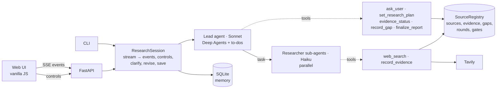

# ResearchAI: a personal research agent

You give ResearchAI a topic. It plans sub-questions and researches them in parallel. It then checks its own evidence, follows up where the evidence is weak, and writes a cited report. You can watch every decision as it happens and step in at any point: pause it, skip a sub-question, or exclude a source.

It is built on **LangChain Deep Agents** and **Claude**. Claude Sonnet 5.5 leads and Claude Haiku 5.5 does the per-source research. Web search uses **Tavily**, the server is **FastAPI**, and past sessions are stored in **SQLite**.

```
topic ─▶ clarify? ─▶ plan ─▶ round 1: research in parallel ─▶ review evidence
                                                                  │ gaps found
           report ◀── citation + gap checks ◀── round 2: targeted follow-up ◀┘
```

---

## Quick start

```bash
python3 -m venv .venv
.venv/bin/pip install -e ".[dev]"
cp .env.example .env            # add ANTHROPIC_API_KEY and TAVILY_API_KEY

# Web UI (recommended)
.venv/bin/uvicorn researchai.server:app --port 8765
# then open http://localhost:8765

# Or the command line
.venv/bin/python -m researchai "Impact of the EU AI Act on European AI startups"

# Tests (offline, free, deterministic)
.venv/bin/pytest
```

A run takes about 2–3 minutes and costs a few cents to tens of cents in API usage.

---

## What it does

| The brief asks for | How ResearchAI does it | Where |
|---|---|---|
| **Autonomous research planning** | The lead agent splits the topic into 3–5 sub-questions and tracks them as a live to-do list. It hands each sub-question to a researcher sub-agent, and they run in parallel. | `prompts.py`, `agent.py` |
| **Proactive, recent information** | Each search result is triaged in code. Duplicates, off-topic results and *outdated* sources (for time-sensitive topics) are dropped, and every decision gets a stated reason. Time-sensitive topics also use news search, which carries publish dates. | `sources.triage`, `search.py` |
| **Clarifying questions; you steer the direction** | Before planning, the agent always asks 1–3 questions, such as *Focus* (pick several angles), *Depth* or *Timeframe*. Each comes with options it proposes for this topic, one recommended. You click to choose, or write your own direction. Research waits for your answer, and the plan follows your choices. Ambiguous topics ("Mercury impact") get a question that resolves the meaning first. | `ask_user` in `tools.py`, `session.py`, `web/app.js` |
| **Adapting the search strategy** | ⭐ **Gap loop.** The agent reviews measured evidence quality (number of sites, recency, verified quotes) and records each gap with *why it matters*. It then runs targeted follow-up searches. The report shows the before and after. | `evidence_status`, `record_gap`, gap gate |
| Summaries and key takeaways *(bonus)* | Researchers record a summary, key takeaways and quoted claims for each source. The report has an executive summary, key takeaways, a section per sub-question, where sources disagree, and open questions. | `record_evidence`, `LEAD_PROMPT` |
| Long-term memory *(bonus)* | Sessions are saved to SQLite. A new topic recalls related past research and passes it to the agent as context. After each report the agent suggests 3 follow-up topics. | `memory.py` |
| **Research summary** | One view of the whole session: your direction, the findings (summary, takeaways, disagreements, open questions), evidence per sub-question, how the agent adapted (gaps with before → after, drafts the checks sent back), source statistics and drop reasons, your actions, and what to research next. Built from the session data, not by an LLM, and downloadable as Markdown. The CLI writes it next to the report. | `summary.py`, `server.py`, `web/app.js` |
| Transparency and oversight *(bonus)* | A live action log of every step, with reasons, labelled by actor (lead, researcher or user). You can **pause/resume** the agent, **skip** a sub-question, or **exclude** a source. Excluding a source the report cites makes the agent revise the report. | `session.py`, `server.py`, `web/` |

---

## Architecture



### The core idea: the LLM drives, code guards

Deep Agents gives the agent real autonomy. It plans with to-dos, delegates to sub-agents with their own context, and decides what to search and write. Every agent action, though, goes through **typed tools backed by one plain-Python `SourceRegistry`**. The rules that matter are enforced there, deterministically, and unit-tested:

| Guardrail | Rule enforced in code |
|---|---|
| Source triage | Drop duplicates (canonical URLs), off-topic results, and sources outside the time window. Rank the rest, giving a reason for each decision. |
| Direction first | No plan can be set until the user has chosen a research direction. |
| Citable IDs | Only sources returned by `web_search` get IDs (`S1`, `S2`…), so the agent cannot cite a source it never saw. |
| Quote verification | Each claim's quote is checked word for word against the source text. |
| Evidence measurement | Each sub-question is flagged as *missing*, *thin* (fewer than 2 different websites), *outdated*, *undated* or *weak_quotes*. |
| Honest gap labels | The agent may only use a measured label such as "thin" when the code actually measured it. Judgement calls use `conflicting` or `missing_angle`. |
| **Citation gate** | The report is rejected if it cites an unknown or excluded source, or leaves a researched sub-question uncited. |
| **Gap gate** | The report is rejected while flagged gaps haven't been followed up and research rounds remain. This guarantees the gap loop happens. |
| Round limit | At most 2 research rounds. After that, gaps still open are *listed* in the report instead of blocking it, so the agent cannot loop forever. |

This split means the agent's behaviour is autonomous, while its guarantees can be tested: 72 tests cover them without any network access.

### Key design decisions

- **Deep Agents rather than a hand-written orchestrator.** Planning with to-dos, sub-agents with their own context, streaming and interrupts all come built in. That left the effort for the agentic behaviour itself: the gap loop and the guardrails.
- **Two models.** Sonnet plans, reviews evidence and writes. Haiku reads sources in parallel. That's cheaper and faster with no loss in reasoning quality.
- **Breadth first, then depth.** Round 1 is a quick pass. Round 2 spends effort *only* where the evidence is weak, which is how a human researcher works.
- **Gaps must explain why they matter.** `record_gap` requires a concrete consequence ("the cost claim would rest on one vendor blog"). That turns extra searching into reasoning a person can check.
- **Ask for direction before planning, like Claude does.** The user knows what they need better than the agent. The agent proposes concrete options, so answering takes a few clicks, not a prompt. A code gate (`set_research_plan` is refused until the direction is chosen) guarantees it happens. Research waits for the user; only a non-interactive CLI falls back to the recommended options, and records them as an assumption.
- **The summary is computed, not generated.** It's assembled from the session's own records, so it can't contradict what actually happened.
- **Pause happens at tool boundaries.** Every tool waits on a pause flag, so a paused agent stops at its next step. A model call already in progress finishes first.
- **Everything is an event.** One event stream feeds the CLI output, the web log, the plan board and storage. The agent never knows who is watching.
- **Simple memory.** Keyword overlap on past topics and sub-questions, instead of embeddings. It's transparent, needs no extra service, and is enough at personal scale.

### Project layout

```
src/researchai/
  agent.py       Deep Agent assembly: Sonnet lead + Haiku researcher sub-agent
  prompts.py     Lead and researcher instructions (breadth → review → depth → write)
  tools.py       The 7 agent tools; every one waits while the session is paused
  sources.py     SourceRegistry: triage, IDs, evidence, measurements, gaps, gates, report appendix
  search.py      TavilySearch (general + news) and FakeSearch for tests
  session.py     Runs the agent, maps stream → events, clarify/timeout, controls, revise, save
  controls.py    Pause/resume
  memory.py      SQLite store, related-research lookup, topic suggestions
  summary.py     Whole-session summary (JSON for the UI, Markdown for download)
  server.py      FastAPI: sessions, SSE event stream, controls, saved sessions
  __main__.py    CLI
  web/           Single-page UI (no build step)
tests/           72 offline tests (fake search + scripted chat models)
```

### Testing

The tests run offline. `FakeSearch` stands in for Tavily, and a scripted chat model makes tool calls in a fixed order, so the **real Deep Agents graph** runs end to end without network or cost. They cover:

- **Task order and dependencies:** no report before a plan and evidence; follow-ups must run before finalising; the round limit.
- **Evidence handling:** triage (duplicates, outdated and undated sources, relevance, credibility), source IDs that stay unique under parallel calls, quote verification, every measured flag.
- **Citations:** every rejection case in the gate, and the source list being appended.
- **The research loop:** a full scripted run (rejected for thin evidence → gap → follow-up → accepted, with the before/after table checked), clarification answered and timed out.
- **Controls:** pause blocks tools, skip rules, exclude rules, revise-on-exclude end to end, the API.
- **Memory:** store round trip, related lookup, memory reaching the agent's prompt, suggestions, read-only saved sessions.

---

## Limitations and next steps

- **Pause takes effect at the next tool call**, not mid-generation.
- **Relevance is the search engine's score.** An LLM relevance judgement during triage would be more accurate, but slower and more expensive.
- **Memory is keyword-based.** Embeddings would catch paraphrased topics ("AI regulation" vs "AI Act").
- **Sessions run in-process.** A real deployment would need a job queue, durable LangGraph checkpoints and authentication.
- **Credibility uses a small domain list.** It could learn from the user's pin and exclude decisions.

See [`docs/DEMO.md`](docs/DEMO.md) for the live demo script.
